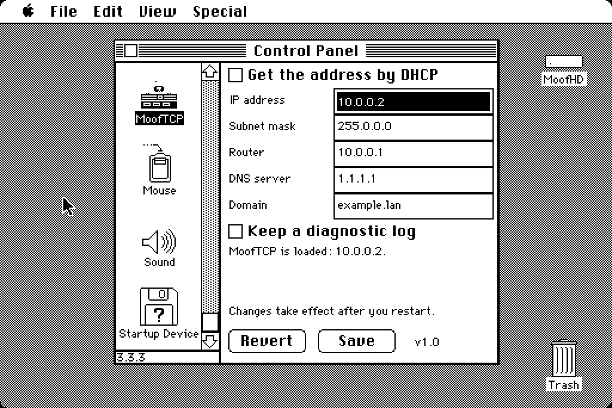
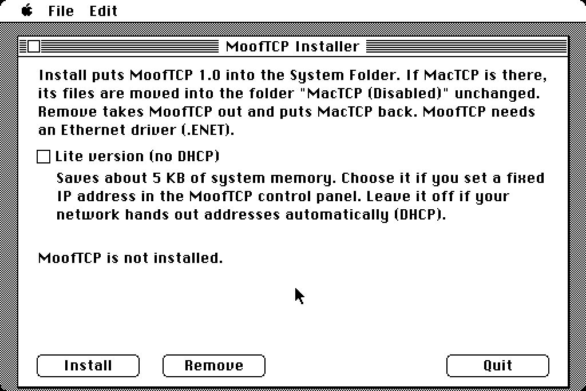
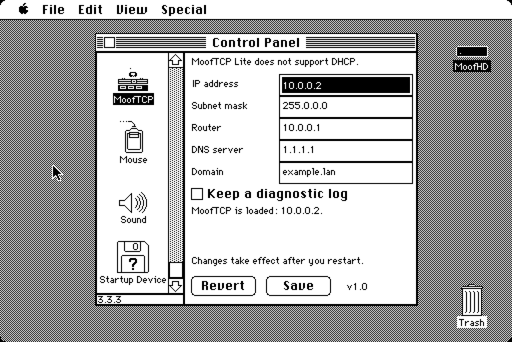

# MoofTCP

**A modern, memory-lean replacement for MacTCP on 68k Macs running System 6.**

[](LICENSE)


MoofTCP is a drop-in replacement for Apple's MacTCP. Programs written for MacTCP run on it unchanged, but
underneath it is a fresh TCP/IP stack written from scratch in portable C, with its own control panel, installer
and DHCP client. It was built for a Mac Classic with 4 MB of RAM, so every byte counts.



## Why?

MacTCP is wonderful, but it is old and closed, and on a 4 MB Mac Classic with a SCSI Wi-Fi/Ethernet adapter like
BlueSCSI it is hungry for memory and awkward to set up. MoofTCP aims, in this order, for:

1. **Reliability.** No hangs, no leaks, no surprises when apps quit.
2. **Low latency** for interactive use, like typing in a telnet session.
3. **Throughput**, for handling quasi-modern use cases.

...all while using **no more resident memory than MacTCP does**.

## Features

- **Drop-in compatible.** Implements the MacTCP `.IPP` driver interface (TCP, UDP, ICMP echo) and the `dnrp`
  name resolver. Your existing MacTCP programs just work.
- **DHCP or a fixed address.** Pick either in the control panel. Don't need to manage static IP anymore.
- **MoofTCP Lite.** A build without DHCP that saves about 5 KB of system memory, for tight machines. One
  installer holds both; a checkbox picks which one.
- **A friendly installer.** It moves MacTCP's files aside, installs MoofTCP, and its Remove button puts
  everything back exactly as it was. An interrupted install repairs itself.
- **MultiFinder-aware.** Quitting an app that had connections open cleans up after it.
- **Built-in diagnostics.** An optional in-memory log and a small `MoofDiag` tool for bug reports.
- **A portable core.** The TCP/IP stack in `core/` has no `malloc` and no global state, and is tested on the
  desktop with sanitizers and fuzzers.

## New in 1.1 (release candidate 1.1rc1)

1.1rc1 is a release candidate. The download on the [Releases](../../releases) page is still 1.0, and the version
badge and file names below stay 1.0 until 1.1 is final.

MoofTCP 1.1 is faster than 1.0. Measured on a real Mac Classic (System 6.0.8, 4 MB, BlueSCSI v2 Wi-Fi), timed on
the PC: MoofTCP 1.1 with [MoofPort](https://github.com/matthewmrichter/moofport/) 1.1 against 1.0's behaviour (the
MoofTCP 1.0 engine, with MoofPort at 1.0's settings). The gains come from both together: MoofTCP 1.1's shorter call
path and MoofPort's `steadyack` timing, which MoofTCP 1.1 switches on. Medians:

|                             | 1.0        | 1.1        |
| --------------------------- | ---------- | ---------- |
| Echo round trip, 1 byte     | TBD-conf3b | TBD-conf3b |
| Terminal burst, 2,000 bytes | TBD-conf3b | TBD-conf3b |
| TCP receive, 1 MB           | TBD-conf3b | TBD-conf3b |
| TCP send, 4 sends queued    | TBD-conf3b | TBD-conf3b |

TBD-conf3b: one-at-a-time sends and AppleShare copies. The figures were measured over Wi-Fi and vary with the
network.

With the DaynaPORT driver the gain is small: MoofTCP leaves DaynaPORT's driver as it is. Echo was about 54.9 ms with
MoofTCP 1.1 against 57.6 ms with 1.0 (two blocks; the 1.0 figure is from an earlier session with different Wi-Fi
settings, so this is not a clean comparison).

Against stock MacTCP with the DaynaPORT driver: MacTCP still answers faster in the echo and terminal tests and sends
queued data faster; MoofTCP 1.1 with MoofPort receives faster (TBD-conf3b: figures).

- A shorter path through every MacTCP call, timer tick and packet.
- With the MoofPort 1.1 driver, MoofTCP switches MoofPort to its `steadyack` timing when it opens the driver. With
  any other driver it changes nothing.
- The timer recovers by itself from a lost Time Manager task, with a once-a-second heartbeat as a backup.
- Resident memory stays below MacTCP's.
- To go back to 1.0: click **Remove** in the 1.1rc1 installer first, then **Install** in the 1.0 installer, and
  restart (the 1.0 installer does not replace a newer MoofTCP). Your settings are kept.

[CHANGELOG.md](CHANGELOG.md) has the full list.

## Screenshots

| Installer                                   | MoofTCP Lite panel                            |
| ------------------------------------------- | --------------------------------------------- |
|  |  |

## Quick start

1. Download `MoofTCP-1.0.dsk`, `MoofTCP-1.0.hqx` or `MoofTCP-1.0.sit` from the
   [Releases](../../releases) page and get it onto your Mac (a BlueSCSI shared folder works well).
2. Open **MoofTCP Installer**, leave **Lite version (no DHCP)** unticked, and click **Install**.
3. Restart the Mac.
4. Open **Control Panels, MoofTCP**, enter your IP address, mask, router and DNS server (or tick
   **Get the address by DHCP**), and save.
5. Restart again. You're online.

To go back to MacTCP, run the installer and click **Remove**. The `Read Me` file in the release has the
details, including how to switch between MoofTCP and MoofTCP Lite.

StuffIt Lite 3.6 is tested as working for expanding the `.hqx` packages.

### What you need

- A 68k Mac with **System 6.0.8** (the version it was tested on). Please report back if it works on other versions!
- An Ethernet adapter that provides the `.ENET0` driver, such as a **BlueSCSI v2 WiFi with DaynaPORT**. MoofTCP
  does not include an Ethernet driver.

## Compatibility

**1.0 results:** tested on a real **Mac Classic** (System 6.0.8, 4 MB, BlueSCSI v2 WiFi with DaynaPORT) and in the
[Snow](https://github.com/twvd/snow) emulator.

| Program (1.0)           | Result                       |
| ----------------------- | ---------------------------- |
| Flynn (telnet terminal) | Works, real Mac and emulator |
| Wikipedia Reader        | Works, real Mac and emulator |
| MacTCP Watcher          | Works in the emulator        |
| NCSA Telnet             | Works in the emulator        |
| Fetch (FTP)             | Works in the emulator        |
| TurboGopher             | Works in the emulator        |
| Eudora                  | Starts; mail was not tried   |

**1.1rc1:** MoofTCP 1.1 ran on the real Mac Classic with the MoofPort driver (10 blocks) and with the DaynaPORT
driver (2 blocks), using the telnet-style echo and terminal tests, TCP send and receive, and AppleShare alongside.
In Snow: the installer (install, switch to MacTCP and back, unattended), MultiFinder runs with two applications
(full and Lite), ApiProbe against MacTCP's recorded answers, and the resident-memory check. The programs in the
table above were not re-run with 1.1.

Have a program that doesn't work? Please open an issue (see below).

## Memory

|                                                                                                    | MoofTCP       | MoofTCP Lite  |
| -------------------------------------------------------------------------------------------------- | ------------- | ------------- |
| Driver code, 1.1rc1                                                                                | 93,746 bytes  | 88,879 bytes  |
| Driver code, 1.0                                                                                   | 95,623 bytes  | 90,722 bytes  |
| Resident over the no-network baseline after network use, 1.1rc1 (emulator; MacTCP: 195,046 bytes) | 171,816 bytes | 166,852 bytes |
| Free system heap after first open, 1.0 (real Mac Classic, single Finder, full build)               | about 30.7 KB | n/a           |

MultiFinder grows the system heap on demand, so free memory varies more there.

## Something went wrong?

MoofTCP keeps a small diagnostic log in memory. If a program misbehaves but the Mac keeps running, run
**MoofDiag** right away (it is in the release's diagnostic tools download), and open an issue with the
`MoofDiag.out` file it writes next to itself, plus a note about what you were doing. Feel free to ask your LLM
to analyze the codebase and the diagnostic output as well and to submit fix PRs.

## Known limitations

- No IPv6.
- Tested only with the DaynaPORT and MoofPort Ethernet drivers on System 6.0.8.
- The timer's once-a-second heartbeat runs only while some program calls `SystemTask`. A program that waits in a
  synchronous MacTCP call on a quiet network calls nothing, so a lost timer task then waits for the next packet
  or call.
- DHCP is basic: no lease RELEASE, no INIT-REBOOT and no address-conflict probe. While it runs, programs cannot
  use UDP port 68. With no DHCP server, the first open waits about 10 seconds and then fails.

### Network setup note: AppleShare at start-up

AppleShare volumes set to open at start-up can fail to mount when the AppleShare server is itself on Wi-Fi with
Wi-Fi power saving on: in tests, between about 1 in 7 and 1 in 3 boots. This is not caused by MoofTCP; AppleTalk
does not use MoofTCP. AppleTalk's start-up lookups are multicast, and a power-saving Wi-Fi receiver misses most of
them (it happened with the stock DaynaPORT driver too, and in 0 of 15 boots with power saving off). Turn power
saving off on the server, use a wired server, or open the volume from the Chooser.

## Building from source

You only need Docker. The pinned [Retro68](https://github.com/autc04/Retro68) cross-compiler image is pulled
automatically.

```sh
scripts/build-mac.sh MoofTCP              # the MoofTCP file -> build-mac/moof/
MT_LITE=1 scripts/build-mac.sh MoofTCP    # MoofTCP Lite -> build-mac-lite/
scripts/release.sh --force 1.0            # one installer with both -> dist/MoofTCP-1.0.{dsk,hqx,sit}
```

`release.sh` also needs hfsutils, macutils, unar, gcc and Python 3.

### Running the tests

The portable core and the glue logic are tested on your desktop with gcc and CMake (AddressSanitizer and
UBSan are on by default):

```sh
cmake -S . -B build && cmake --build build
ctest --test-dir build --output-on-failure
cmake -S . -B build-lite -DMT_NO_DHCP=ON   # the Lite configuration
```

The emulator tests (Snow) need Apple system software and the BlueSCSI DaynaPORT image. Those are not in this
repository and you must supply them yourself; the scripts in `scripts/` (`setup-home.sh`, `golden-stage.sh`) show
what is expected.

## Project layout

```
core/      portable TCP/IP stack (no malloc, no globals), host-tested
mac/       Mac glue: .IPP driver, INIT, resolver, control panel, installer, diagnostic apps
tests/     host tests (ctest), including fuzzers
scripts/   build, release, emulator and hardware-session scripts
tools/     pinned tool versions; tools/sit is a small StuffIt-format writer
```

## Contributing

Bug reports, compatibility reports ("program X does/doesn't work") and pull requests are welcome. For code
changes, please read [CONTRIBUTING.md](CONTRIBUTING.md) and run the host tests first (see above). `CLAUDE.md` is a
detailed map of the code and its rules. Security problems: see [SECURITY.md](SECURITY.md).

## Credits

- [Retro68](https://github.com/autc04/Retro68) for the 68k cross-compiler.
- [Snow](https://github.com/twvd/snow) for the Mac emulator the tests run in.
- [BlueSCSI](https://bluescsi.com) and DaynaPORT for the network hardware this was built around.
- [Claude Code](https://claude.ai) was used to develop this project, with human planning and testing.

## TODO

- More comprehensive bake-in testing on real hardware as we use it
- Remake Daynaport similarly (stay tuned for _MoofPort_)
- Review the BlueSCSI codebase for opportunities to integrate more tightly for better performance
- There is potential for further algorithm optimization for added performance on smaller or older systems.

## License

[MIT](LICENSE). "MacTCP" and "StuffIt" are trademarks of their owners and are used here only to describe
compatibility. MoofTCP contains no Apple or third-party code; building it uses Apple's interfaces as shipped in
the Retro68 toolchain.
